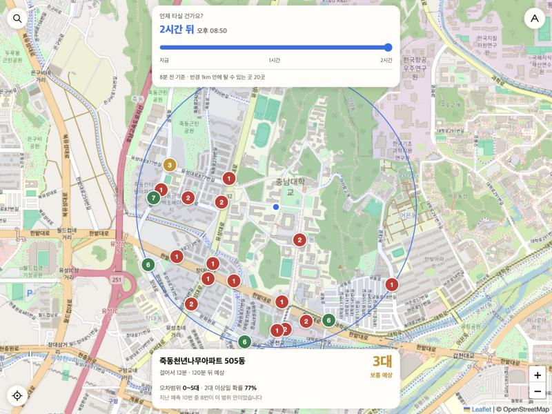
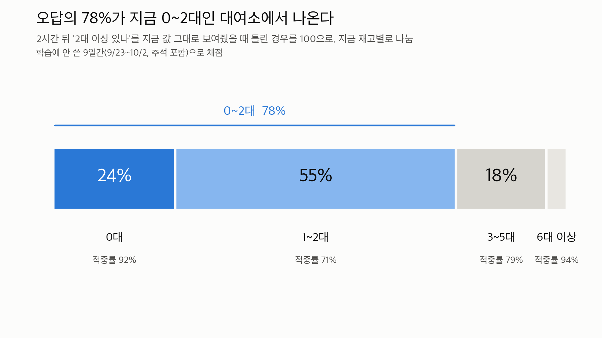
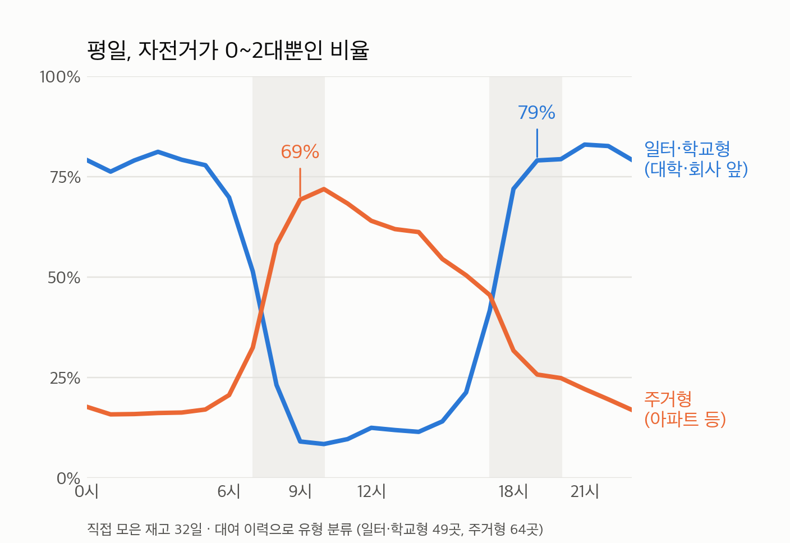

# 공영자전거 타슈 예측 프로그램

대전 공영자전거 **타슈**의 대여소별 자전거 수를 **10분~2시간 뒤**까지 예측하고,
그 예측을 얼마나 믿어도 되는지(오차범위·2대 이상 있을 확률)까지 보여주는 웹 서비스입니다.

- 서비스: https://jineeus7.github.io/tashu-collector/ (데이터 수집 종료, 마지막 예측 화면이 남아 있음)
- 팀: 탈수있슈 · 2026 숙명여대 빅데이터 경진대회, 2026 DRIVE 경진대회(빅데이터 COSS 대표팀 선발전) 출전



## 문제

- 대전 대여소 약 1,376곳 중 **절반 가까이가 0대**, 78%가 0~2대입니다. 빌리러 갔는데 없는 헛걸음이 흔합니다.
- 기존 타슈 앱은 **지금 재고만** 보여줍니다. 이용자가 궁금한 건 "1~2시간 뒤 내가 갈 때 남아 있을까?"입니다.
- 예측하려면 과거 재고 기록이 필요한데, 공개된 데이터는 대여 이력뿐이고 **과거 재고 기록은 없었습니다.**

## 접근

1. **재고를 직접 모았다** — 타슈 오픈 API를 10분마다 호출해 이 저장소에 쌓았습니다 (GitHub Actions, 비용 0원).
2. **재고만으로는 안 됐다** — 재고만 학습한 모델 84.2% vs 지금 값 그대로 83.9%. 데이터를 1주→23일로 늘려도 같았습니다.
3. **어디서 틀리는지 봤다** — 오답의 78%가 지금 0~2대인 대여소. 한두 명의 대여·반납에 답이 뒤집히는데, 그건 재고 숫자에 없습니다.
4. **대여 이력의 "평소 흐름"을 더했다** — 대여 이력 20개월(911만 건)에서 대여소·요일·시간대별 평소 대여·반납량을 뽑아 피처로 넣었습니다.
5. **확률까지 붙여 서비스했다** — 검증 기간의 실제 결과로 "3대 예상이면 실제 0~5대, 2대 이상일 확률 77%" 같은 표를 만들어 화면에 보여줍니다.

| 오답 위치 | 대여소 유형별 패턴 |
|---|---|
|  |  |

## 결과

모델이 처음 보는 **9일간(9/23~10/2, 추석 포함)** 으로 채점. 비교 기준은 기존 앱처럼 "지금 재고가 그대로"라고 본 것입니다.

| 2시간 뒤 | 지금 값 그대로 (기존 앱) | 우리 모델 |
|---|---|---|
| 평균 오차 | 0.902대 | **0.789대 (12%↓)** |
| 2대 이상 있나 적중률 | 83.9% | 85.5% |
| 1~2대 대여소 적중률 | 71.2% | 75.0% (틀린 예측 **13%↓**) |
| 출근 시간(6~9시) 평균 오차 | 1.20대 | 0.88대 (26%↓) |
| 1시간 안 큰 변화(3대+) 미리 잡기 | 0% | **56%** |
| "있다"고 했는데 실제로 없던 경우 | 43,220건 | 39,462건 (9%↓) |

한계: 가을 한 계절(재고 32일) 데이터라 **비 오는 날은 아직 기존 방식보다 못하고**, 명절 당일에 약합니다.
날씨 변수를 넣는 실험도 했지만 효과가 없었습니다 ([실험 기록](model/experiments/README.md)).

## 저장소 구조

```
.
├── collect.py            # 타슈 오픈 API에서 재고 한 번 수집 → data/날짜/시각.json.gz
├── predict.py            # 최근 수집분으로 12개 시점(10~120분) 예측 → site/*.json
├── .github/workflows/
│   └── collect.yml       # 10분마다 수집 → 예측 → 사이트 배포 (현재 꺼 둠)
├── data/                 # 수집한 재고 스냅샷 5,900여 개 → data/README.md
├── model/                # 배포 모델과 학습 코드 → model/README.md
│   └── experiments/      # 모델을 고르기까지의 실험과 결과
├── site/                 # 웹 화면 (지도 index.html, 큰 글씨 easy.html)
├── tools/                # 데이터 읽기·백업·수집 간격 확인
└── docs/                 # 진행 과정, 발표용 그래프
```

- 진행 과정과 날짜별 기록: [docs/진행과정.md](docs/진행과정.md)
- 피처 23개와 모델 설정: [model/README.md](model/README.md)

## 직접 돌려 보기

```bash
pip install numpy xgboost
python3 model/train.py data          # 학습 (대여 이력 흐름은 model/flow_profile.npz 사용)
python3 predict.py                   # 가장 최근 수집분으로 예측 → site/predictions.json
python3 -m http.server -d site 8000  # http://localhost:8000 에서 화면 확인
```

수집(`collect.py`)은 타슈 오픈 API 토큰이 필요합니다(환경변수 `TASHU_API_TOKEN`).

## 사용한 데이터

| 데이터 | 출처 | 규모 |
|---|---|---|
| 실시간 재고 | 타슈 오픈 API (대전교통공사) | 10분 간격, 2026-08-31 ~ 10-11 (+ 10-29~30) |
| 대여 이력 | 공공데이터포털 "대전교통공사_타슈 대여이력 정보" | 2024-08 ~ 2026-03, 911만 건 (저장소에는 집계본 `model/flow_profile.npz`만) |

## 기술

Python · XGBoost · NumPy · GitHub Actions(수집·예측 자동화) · GitHub Pages(배포) · Leaflet + OpenStreetMap(지도)
