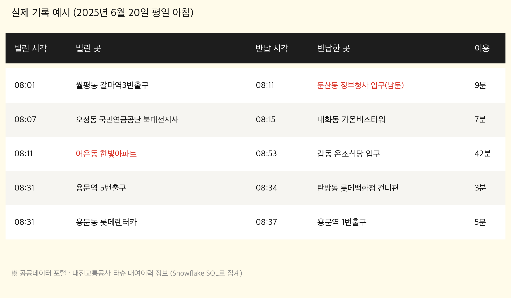
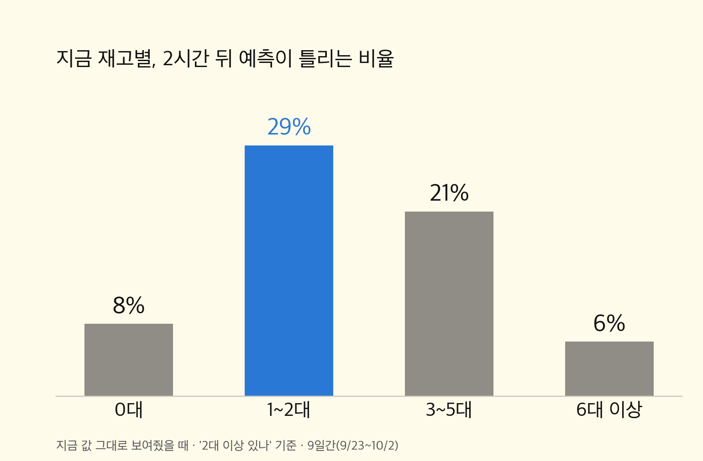
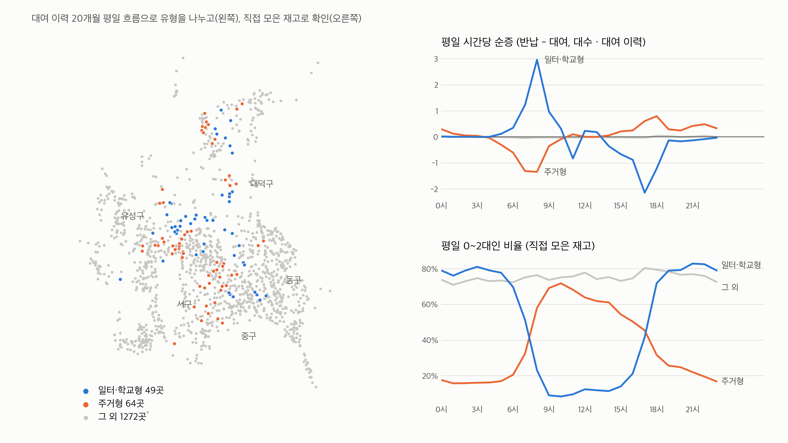
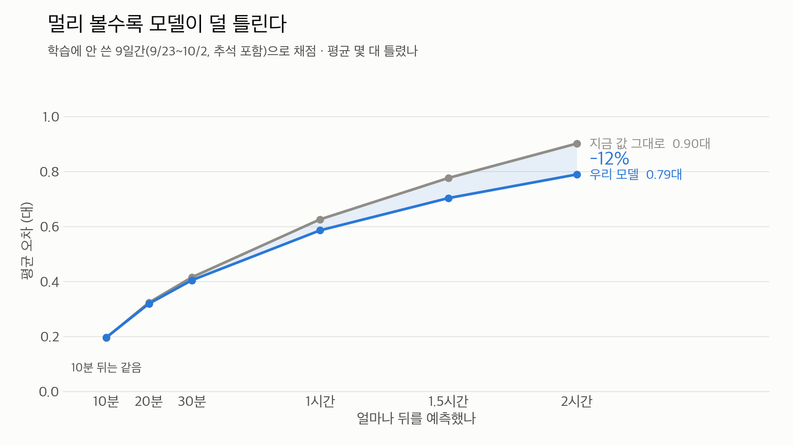
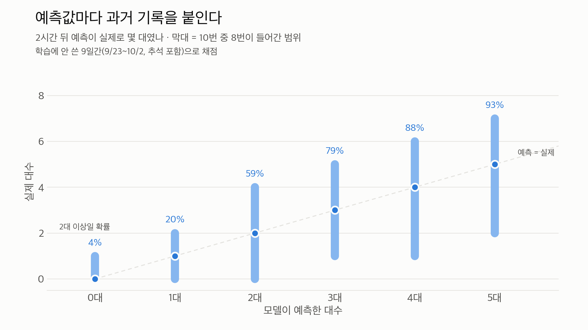

# 진행 과정

## 출발점: 재배치 추천 → 이용자용 재고 예측

숙명여대 빅데이터 캠프(해커톤)에서는 대여 이력 20개월로 대여소별 시간당 순이동량을 예측하는
"트럭 재배치 추천"을 만들었습니다. 한계는 **과거 재고 기록이 없다**는 것이었습니다.
대여 이력으로 재고를 거꾸로 계산해 보면 한 달 만에 대여소 11%가 ±20대씩 어긋났습니다(트럭 재배치 기록이 없어서).

그래서 두 가지를 바꿨습니다.
- 재고를 **직접 수집**한다
- 운영자가 아니라 **이용자**의 질문에 답한다: "1~2시간 뒤 내가 갈 때 자전거가 남아 있을까?"

## 날짜별 기록

| 날짜 | 한 일 |
|---|---|
| 8/31 | 수집기 구축 — 타슈 오픈 API를 10분마다 호출해 이 저장소에 저장 (GitHub Actions) |
| 9/5 ~ 9/10 | 수집 안정화 — 네트워크 오류 재시도, GitHub 예약 실행이 밀리는 문제를 "실행이 끝나기 전에 다음 실행을 스스로 띄우는 사슬 구조"로 해결 |
| 9/11 | 첫 예측 모델(재고만 학습) + 지도 웹앱 공개, 큰 글씨 화면 추가 |
| 9/12 ~ 9/14 | 둔감폭 도입(확신이 설 때만 값 변경), 학습 시각 9시간 밀림 버그 수정, 화면 정리 |
| 9월 중순 | **재고만으로는 안 됨** 확인 — 84.2% vs 지금 값 그대로 83.9%, 데이터를 1주→23일로 늘려도 같음 |
| 9/22 | **대여 이력의 평소 흐름 결합**, 예측마다 오차범위·2대 이상 확률 표시 |
| 9/28 | 공휴일을 일요일로 처리 (추석 오차 악화의 약 3/4 회복) |
| 10/2 | 최종 모델 — 어제·그제·지난주 같은 시각의 실제 변화 추가, 모델 확대 (피처 23개) |
| 10/3 ~ 10/9 | 9일간 검증으로 발표 숫자 재계산, 알고리즘 비교, 발표 자료·대본 준비 |
| 10/7 ~ 10/8 | 예측을 10분 단위 12개 시점으로 확장, 슬라이더 개선·버그 수정 |
| 10/10 | 2026 DRIVE 경진대회 빅데이터 대표팀 선발전 발표 |
| 10/11 | 수집 1차 종료 |
| 10/12 | 날씨 변수 실험 → 효과 없음, 미배포 |
| 10/29 ~ 10/30 | 발표 시연용으로 수집 재개 후 종료 |

## 핵심 흐름 (발표 스토리)

1. 과거 재고 기록이 없다 → 10분마다 직접 모았다 (32일, 4,476개, 비용 0원)
2. 재고만으로 학습 → 기존 앱과 차이 없음 → **양이 아니라 정보 종류의 문제**
3. 어디서 틀리나 → 지금 1~2대인 대여소 (4번 중 1번 넘게 틀림). 한두 명의 대여·반납에 답이 바뀌는데 그건 재고 숫자에 없다
4. 대여 이력 20개월의 평소 흐름을 더함 → 같은 1~2대라도 일터·학교 근처는 저녁에, 주거지는 아침에 빈다
5. 결과 → 1~2대 대여소 틀린 예측 13%↓, 2시간 뒤 평균 오차 12%↓, 큰 변화 56% 미리 감지
6. 서비스 → 반경 1km, 고른 시각에 탈 수 있는 곳만, 예측마다 "2대 이상 있을 확률"

| | |
|---|---|
|  |  |
|  |  |
|  |  |
|  |  |

## 한계와 다음 단계

- 가을 한 계절(재고 32일)뿐 → 겨울·장마 검증 못 함
- **비 오는 날은 아직 기존 방식보다 못함**, 명절 당일 약함. 날씨 변수 실험은 한 달 데이터로는 효과 없음
- 트럭 재배치 기록이 없어 큰 변화의 44%는 놓침
- 실제 사용자 조사·운영 기관 협의는 하지 못함
- 다음: 데이터를 계속 쌓아 재학습, 계절 데이터가 쌓이면 날씨 재반영, 공공 API만 쓰는 구조라 다른 도시 공영자전거로 확장 가능
