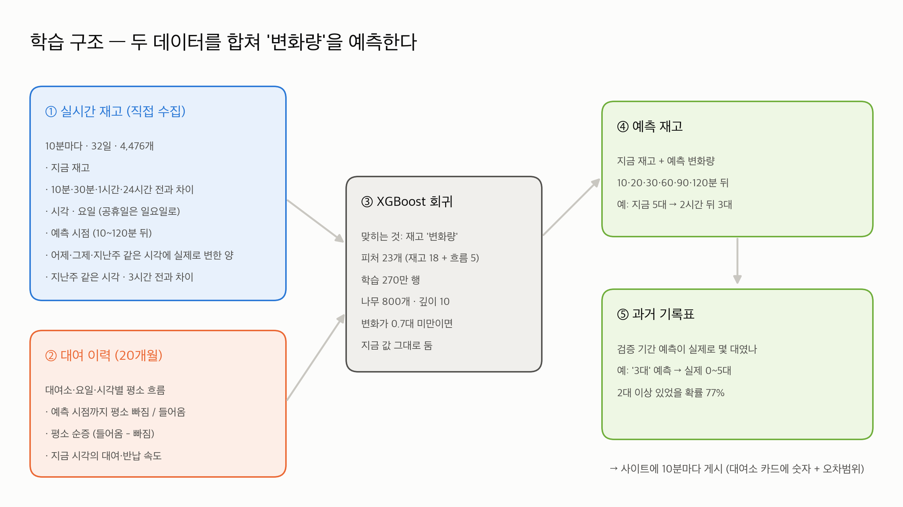
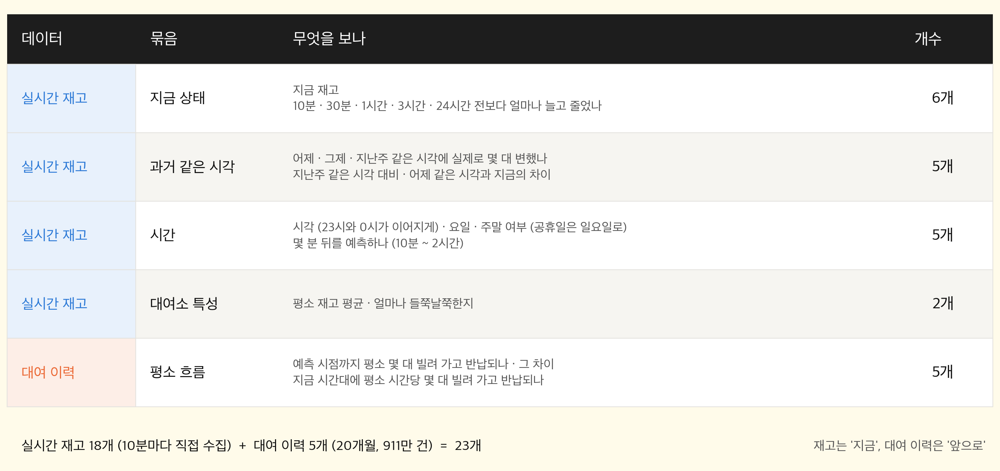
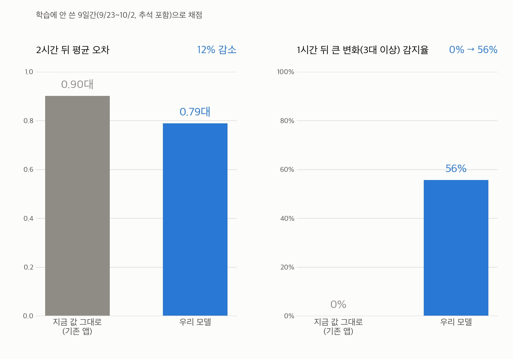

# 예측 모델

## 무엇을 맞히나

- **재고 자체가 아니라 변화량** (예측 시점 재고 − 지금 재고)을 맞힙니다.
- 예측값 = 지금 재고 + 예측 변화량. 변화량이 **0.7대 미만이면 지금 값을 그대로** 두고, 반올림하고, 0 아래는 0으로 자릅니다.
- 학습 시점은 10·20·30·60·90·120분 뒤이고, 사이트는 10분 단위 12개 시점(10~120분)을 냅니다.

## 설정

XGBoost 회귀 · 나무 800개 · 깊이 10 · 학습률 0.04 · subsample 0.8 · colsample 0.8 · min_child_weight 100 · hist
학습 데이터: 재고 32일(8/31~10/2) 4,476개 스냅샷 → 약 270만 행

## 피처 23개 (실시간 재고 18 + 대여 이력 흐름 5)

| 묶음 | 피처 |
|---|---|
| 지금 상태 (6) | 현재재고, 10분·30분·1시간·3시간·24시간 전 대비 차이 |
| 과거 같은 시각 (5) | 어제·그제·지난주 같은 시각부터 실제로 변한 양, 지난주 같은 시각 대비, 어제 목표 시각 재고 − 지금 |
| 시간 (5) | 시각 sin·cos, 요일(공휴일은 일요일), 주말, 예측 시점(분) |
| 대여소 특성 (2) | 평소 재고 평균, 평소 재고 변동(표준편차) |
| 대여 이력 흐름 (5) | 예측 시점까지 평소 대여·반납·순증, 지금 시각의 시간당 대여·반납 속도 |

## 파일

| 파일 | 내용 |
|---|---|
| `train.py` | 학습. `python3 model/train.py data` → 아래 json들을 다시 만듦 |
| `flow.py` | 학습·예측 공용: 공휴일 목록, 대여 이력 흐름 피처, 과거 같은 시각 피처 |
| `flow_profile.py` | 대여 이력 원본(공공데이터포털 CSV) → `flow_profile.npz` (요일 7 × 24시 × 대여소, 시간당 평균 대여·반납) |
| `flow_profile.npz` | 위 결과. 대여 이력 원본(약 400MB) 대신 이 집계본만 저장소에 둠 |
| `model.json` | 학습된 XGBoost 모델 |
| `model_meta.json` | 피처 이름 순서, 학습 시점, 학습 행 수 |
| `station_stats.json` | 대여소별 평소 재고 평균·표준편차 |
| `calibration.json` | 오차범위표: 예측값별 실제값 10~90% 범위와 2대 이상 비율 (학습 때 떼어 둔 마지막 20% 기간으로 계산) |
| `experiments/` | 모델을 고르기까지의 실험 → [experiments/README.md](experiments/README.md) |

## 성능 (9일간 9/23~10/2, 2시간 뒤)

평균 오차 0.902 → **0.789대 (12%↓)**, 2대 이상 적중률 83.9 → 85.5%, 1~2대 대여소 틀린 예측 13%↓,
1시간 안 큰 변화(3대+) 감지 0 → 56%. 자세한 숫자: [experiments/results/summary_9days.txt](experiments/results/summary_9days.txt)

